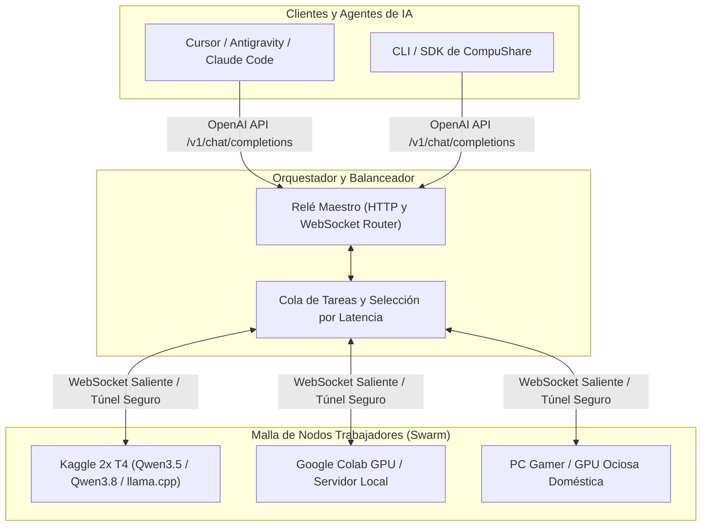

# CompuShare: La Computadora Compartida

<p align="center">
  
</p>

<p align="center">
  <strong>Red Distribuida de Cómputo e Inferencia de Inteligencia Artificial</strong><br />
  <em>Une computadoras personales, servidores comunitarios y GPUs ociosas en una sola supercomputadora de inferencia.</em>
</p>

<p align="center">
  <a href="https://github.com/EnmanuelReynoso23/CompuShare/blob/main/LICENSE"></a>
  <a href="https://www.python.org/"></a>
  
  
  
</p>

---

> *"No necesitamos centros de datos gigantescos controlados por unos pocos. El poder ya está aquí, distribuido en millones de máquinas conectadas que, juntas, forman una sola supercomputadora."*

---

## 💡 Manifiesto y Visión

Hoy en día, el acceso a los modelos de inteligencia artificial más potentes está hipercentralizado. Dependemos de un puñado de corporaciones que controlan los centros de datos y cobran por cada token generado.

**CompuShare** nace del análisis sobre el futuro inevitable del cómputo: **la computadora compartida**.

De la misma forma que BitTorrent descentralizó el almacenamiento y Folding@home demostró que millones de computadoras personales podían superar a las mayores supercomputadoras científicas del mundo, **CompuShare** une recursos de cómputo diversos (laptops personales, GPUs ociosas, instancias de Kaggle, Google Colab y servidores comunitarios) en una **malla global de inferencia**.

- **Quien tiene cómputo ocioso:** lo aporta a la red como **Nodo Trabajador** con un solo comando.
- **Quien necesita inferencia:** consume de la red mediante una interfaz estándar compatible con **OpenAI** (`/v1/chat/completions`) desde Cursor, Antigravity, Claude Code o cualquier SDK.
- **Modelos que no caben en una sola máquina:** se dividen por capas (*pipeline parallelism*) entre varias máquinas conectadas.

---

## 🏛️ Arquitectura General



### Componentes Clave:
1. **Relé Maestro (`compushare-relay`):** Punto de encuentro ligero que expone la API compatible con OpenAI y distribuye los prompts entrantes hacia los nodos disponibles según latencia, memoria libre y carga activa.
2. **Nodos Trabajadores (`compushare-worker`):** Ejecutan modelos abiertos (como Qwen 2.5/3.5/3.8, DeepSeek, Llama) usando motores de alto rendimiento (`llama.cpp`, `vLLM` u `Ollama`).
3. **Conexiones Salientes Seguras:** Los workers se conectan hacia el Relé mediante WebSockets directos o túneles Cloudflare, sin necesidad de abrir puertos en routers domésticos ni lidiar con cortafuegos.
4. **Sinergia con SynRAG:** Los agentes que consumen CompuShare utilizan [SynRAG](https://github.com/EnmanuelReynoso23/synrag) como motor AST local para mandar por la red solo los fragmentos de código necesarios (-63,9 % de tokens de prompt medidos en tareas reales).

---

## 🚀 Hoja de Ruta y Estado del Proyecto

- [x] **Fase 0 (Prototipo validado):** Pruebas de concepto iniciales en Kaggle con nodos maestro, trabajador, relé WebSocket y modelos Qwen vía `llama.cpp`.
- [x] **Fase 1 (Desacoplamiento e Infraestructura Core):** Protocolo WebSocket con streaming token a token, Relé Maestro con endpoint OpenAI `/v1/chat/completions` (SSE), Nodo Trabajador y scripts de despliegue para Kaggle.
- [ ] **Fase 2 (Protocolo de Descubrimiento):** Registro dinámico de nodos mediante tokens/identificadores sin necesidad de reconfigurar URLs a mano.
- [ ] **Fase 3 (Tolerancia a Nodos Efímeros):** Reintento transparente de inferencia si una sesión de Kaggle/Colab expira a mitad de una respuesta.
- [ ] **Fase 4 (CLI Universal):** `compushare join` para donar cómputo en 1 línea y `compushare serve` para levantar el endpoint local.

Documentación técnica y planes detallados:
- 📋 [PLAN.md](PLAN.md) — Plan de trabajo integral y estado de agentes.
- 📐 [docs/MATEMATICA.md](docs/MATEMATICA.md) — Calibración de latencias, fórmulas de rendimiento y throughput medido.
- 📊 [docs/ESTADO-Y-PENDIENTES.md](docs/ESTADO-Y-PENDIENTES.md) — Estado actual y tareas pendientes.

---

## ⚡ Guía de Inicio Rápido (CLI)

### Instalación

```bash
git clone https://github.com/EnmanuelReynoso23/CompuShare.git
cd CompuShare

# Crear entorno e instalar dependencias con uv
uv venv
source .venv/bin/activate    # En Windows: .\.venv\Scripts\activate
uv pip install -e .
```

### 1. Iniciar el Relé Maestro (Orquestador + API OpenAI)

```bash
compushare servir --puerto 8000
```

Esto levanta de forma inmediata:
- **Dashboard web en tiempo real:** `http://localhost:8000/`
- **Endpoint compatible con OpenAI:** `http://localhost:8000/v1/chat/completions`
- **Catálogo de modelos disponibles:** `http://localhost:8000/v1/models`
- **Canal WebSocket para trabajadores:** `ws://localhost:8000/ws/worker`

### 2. Conectar un Nodo Trabajador al Enjambre

```bash
# Modo local con backend llama.cpp o vLLM
compushare unirse --rele ws://127.0.0.1:8000/ws/worker --modelo qwen2.5-coder --backend llama.cpp

# Modo simulado para pruebas de desarrollo (sin necesidad de GPU)
compushare unirse --rele ws://127.0.0.1:8000/ws/worker --modelo qwen2.5-coder --backend simulado
```

### 3. Probar la Inferencia Distribuida

```bash
compushare probar --url http://127.0.0.1:8000 --modelo qwen2.5-coder --prompt "¿Cómo funciona CompuShare?"
```

---

## 🔌 Uso con Clientes de IA (Cursor, Antigravity, Python)

Al ser 100 % compatible con el estándar de OpenAI, puedes configurar CompuShare en cualquier cliente:

```python
from openai import OpenAI

client = OpenAI(
    base_url="http://localhost:8000/v1",
    api_key="compushare-local"
)

response = client.chat.completions.create(
    model="qwen2.5-coder",
    messages=[{"role": "user", "content": "Escribe una función en Python para merge sort"}],
    stream=True
)

for chunk in response:
    if chunk.choices[0].delta.content:
        print(chunk.choices[0].delta.content, end="", flush=True)
```

---

## ☁️ Despliegue en Kaggle y Google Colab

Puedes donar las GPUs gratuitas de Kaggle (2x NVIDIA Tesla T4) al enjambre ejecutando el script automatizado:

```python
# En una celda de Kaggle con GPU T4 x 2 e Internet habilitado:
!git clone https://github.com/EnmanuelReynoso23/CompuShare.git
%cd CompuShare
!python scripts/kaggle/worker_kaggle.py "wss://tu-rele.tudominio.com/ws/worker"
```

El script se encarga de descargar `llama-server` optimizado para CUDA, el modelo GGUF cuantizado y conectarse al relé de forma desatendida. Para más detalles, consulta la [Guía de Kaggle](scripts/kaggle/README.md).

---

## 📂 Estructura del Repositorio

```text
compushare/
├── fabric/                   # Red funcional: relé, tubos, nodos y reparto de capas
│   ├── kaggle/               # Lanzador y automatización para Kaggle
│   ├── nodo/                 # Motores locales de inferencia (llama.cpp, RPC)
│   ├── rele/                 # Relé de coordinación y ruteo
│   ├── simulador/            # Simulador de enlaces TCP con jitter y pérdida
│   └── web/                  # Dashboard frontend en React + Vite + Tailwind
├── src/compushare/           # Paquete Python estándar y CLI universal
│   ├── cli.py                # Comandos: servir, unirse, probar, info
│   ├── nodo/                 # Nodo Maestro y Nodo Trabajador
│   ├── rele/                 # Servidor HTTP/WebSocket y enrutador balanceador
│   └── protocolo.py          # Protocolo de mensajes tipado en Pydantic v2
├── scripts/kaggle/           # Scripts de arranque para workers remotos
├── tests/                    # Suite de pruebas automatizadas
├── docs/                     # Documentación matemática y análisis técnico
├── pyproject.toml            # Configuración del paquete y dependencias
├── LICENSE                   # Licencia de código abierto MIT
└── README.md
```

---

## 🛠️ Tecnologías y Lenguajes

| Lenguaje / Tecnología | Rol en CompuShare | Archivos / Líneas |
| :--- | :--- | :---: |
| **Python (3.10+)** | **Motor Central, Relé y CLI:** Orquestación asíncrona (`asyncio`, `aiohttp`, `websockets`), tipado estricto con `Pydantic v2`, CLI con `Typer`/`Rich`, simulador de red TCP y suite de pruebas (`pytest`). | 47 archivos (~7.700 líneas) |
| **TypeScript & React** | **Dashboard Web y Frontend:** Interfaz visual de monitorización del enjambre (`fabric/web/`), construida con React, Vite y Tailwind CSS. | 11 archivos (~1.450 líneas) |
| **C / C++ & CUDA** | **Motor de Inferencia de Alto Rendimiento:** Backend de ejecución basado en `llama.cpp` y `ggml-rpc-server`, con aceleración por hardware en GPUs NVIDIA (Tesla T4, P100, RTX). | Binarios y bindings |
| **Shell / Bash & Docker** | **Despliegue y Automatización:** Scripts para provisionamiento autónomo en entornos efímeros (Kaggle / Google Colab) y contenedorización (`Dockerfile`, `docker-compose.yml`). | 3 archivos |
| **Markdown, TOML & JSON** | **Especificaciones Matemáticas y Configuración:** Modelado formal de latencias (`MATEMATICA.md`), informes de pruebas empíricas y manifiesto de empaquetado. | ~33 archivos |

---

## 📄 Licencia

Este proyecto está bajo la licencia de código abierto **MIT** - consulta el archivo [LICENSE](LICENSE) para más detalles.
