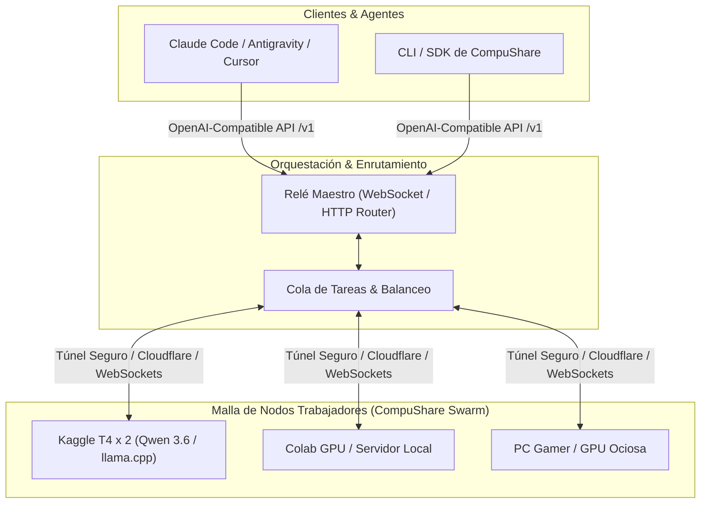

# CompuShare: La Computadora Compartida

**Red Distribuida de Cómputo e Inferencia de Inteligencia Artificial**

> *"No necesitamos centros de datos gigantescos controlados por unos pocos. El poder ya está aquí, distribuido en millones de máquinas conectadas que, juntas, forman una sola supercomputadora."*

---

## Manifiesto y Visión

Hoy en día, el acceso a la inteligencia artificial de vanguardia está hipercentralizado. Dependemos de un puñado de corporaciones que controlan la infraestructura y cobran por cada token generado. 

**CompuShare** nace del análisis sobre el futuro inevitable del cómputo: **la computadora compartida**. 

De la misma forma que BitTorrent descentralizó el almacenamiento y Folding@home demostró que millones de computadoras personales podían superar a las mayores supercomputadoras científicas del mundo, **CompuShare** une recursos de cómputo diversos (laptops personales, GPUs ociosas, instancias de Kaggle, Google Colab y servidores comunitarios) en una **malla global de inferencia**.

En CompuShare:
- Quien tiene cómputo ocioso lo aporta a la red como **Nodo Trabajador**.
- Quien necesita ejecutar tareas o razonamiento de IA consume de la red mediante una interfaz estándar compatible con OpenAI.
- Los nodos efímeros (que nacen y mueren en plataformas como Kaggle o Colab) se orquestan sin interrumpir el servicio.

---

## Arquitectura General



### Componentes Clave:
1. **Relé Maestro (`compushare-relay`):** Punto de encuentro ligero que distribuye los prompts entrantes hacia los nodos disponibles según su latencia, modelo cargado y carga actual.
2. **Nodos Trabajadores (`compushare-worker`):** Ejecutan modelos de lenguaje abiertos (como Qwen 3.6/3.8, DeepSeek, Llama) usando motores de alto rendimiento como `llama.cpp` o `vLLM`.
3. **Túneles Seguros:** Conexión de nodos detrás de NAT/firewalls mediante túneles Cloudflare, Tailscale o WebSockets directos.
4. **Sinergia con SynRAG:** Los agentes que consumen CompuShare utilizan **SynRAG** como motor AST local para mandar por la red solo los fragmentos de código que hacen falta. Medido en SynRAG: -63,9 % de tokens con un agente real en 10 tareas de varios pasos (CLAIMS fila 41 de SynRAG); no está medido sobre CompuShare.

---

## Estado y Plan

Lo que funciona hoy está en `fabric/` (relé, tubo, nodos, reparto de capas, cuadernos de Kaggle) y en el nuevo paquete estándar `src/compushare/`.
Medido el 31-oct-2026: Qwen3.5-9B Q8_0 dividido en 2 cuadernos de Kaggle (4 GPU) genera 10,3-10,8 tok/s
con decodificación especulativa (`fabric/kaggle/resultados/20261031-dividido`). Fases y tareas:
[PLAN.md](PLAN.md); la matemática de la red: [docs/MATEMATICA.md](docs/MATEMATICA.md).

- [x] **Fase 0 (Prototipo validado):** Pruebas de concepto iniciales en Kaggle con nodos maestro, trabajador, relé WebSocket y modelos Qwen vía `llama.cpp`.
- [x] **Fase 1 (Desacoplamiento e Infraestructura Core):** Protocolo WebSocket con streaming token a token, Relé Maestro con endpoint OpenAI `/v1/chat/completions` (SSE), Nodo Trabajador y scripts de despliegue para Kaggle.
- [ ] **Fase 2 (Protocolo de Descubrimiento):** Registro dinámico de nodos mediante tokens/identificadores sin necesidad de reconfigurar URLs a mano.
- [ ] **Fase 3 (Tolerancia a Nodos Efímeros):** Reintento transparente de inferencia si una sesión de Kaggle/Colab expira a mitad de una respuesta.
- [ ] **Fase 4 (CLI Universal):** `compushare join` para donar cómputo en 1 línea y `compushare serve` para levantar el endpoint local.

---

## ⚡ Guía de Inicio Rápido (CLI)

### 1. Iniciar el Relé Maestro (Orquestador + API OpenAI)
```bash
compushare servir --puerto 8000
```
Esto levanta:
- Dashboard de monitorización en tiempo real: `http://localhost:8000/`
- Endpoint compatible con OpenAI: `http://localhost:8000/v1/chat/completions`
- Endpoint de modelos activos: `http://localhost:8000/v1/models`
- Canal WebSocket para workers: `ws://localhost:8000/ws/worker`

### 2. Conectar un Nodo Trabajador
Para donar cómputo o conectar una máquina local/remota:
```bash
# Modo local con llama.cpp o vLLM
compushare unirse --rele ws://127.0.0.1:8000/ws/worker --modelo qwen2.5-coder --backend llama.cpp

# Modo simulado para pruebas de desarrollo
compushare unirse --rele ws://127.0.0.1:8000/ws/worker --modelo qwen2.5-coder --backend simulado
```

### 3. Probar la Inferencia Distribuida
```bash
compushare probar --url http://127.0.0.1:8000 --modelo qwen2.5-coder --prompt "Escribe un merge sort en Python"
```

---

## 📂 Estructura del Proyecto

```text
compushare/
├── fabric/               # Red que ya funciona: relé, tubo, nodos, Kaggle (traído de synrag-fabric)
├── src/
│   └── compushare/
│       ├── __init__.py
│       ├── cli.py          # Interfaz de línea de comandos
│       ├── nodo/           # Lógica del nodo (maestro y trabajador)
│       │   ├── maestro.py
│       │   └── trabajador.py
│       └── rele/           # Enrutamiento de tareas y WebSocket
│           ├── enrutador.py
│           └── servidor.py
├── scripts/
│   └── kaggle/             # Cuadernos y guiones para workers en Kaggle
├── tests/
├── pyproject.toml
├── LICENSE
└── README.md
```

---

## Licencia

Este proyecto está bajo la licencia **MIT** - consulta el archivo [LICENSE](LICENSE) para más detalles.
